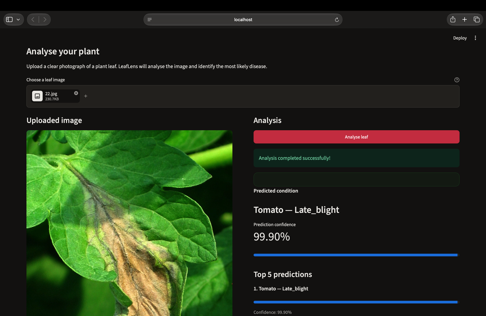
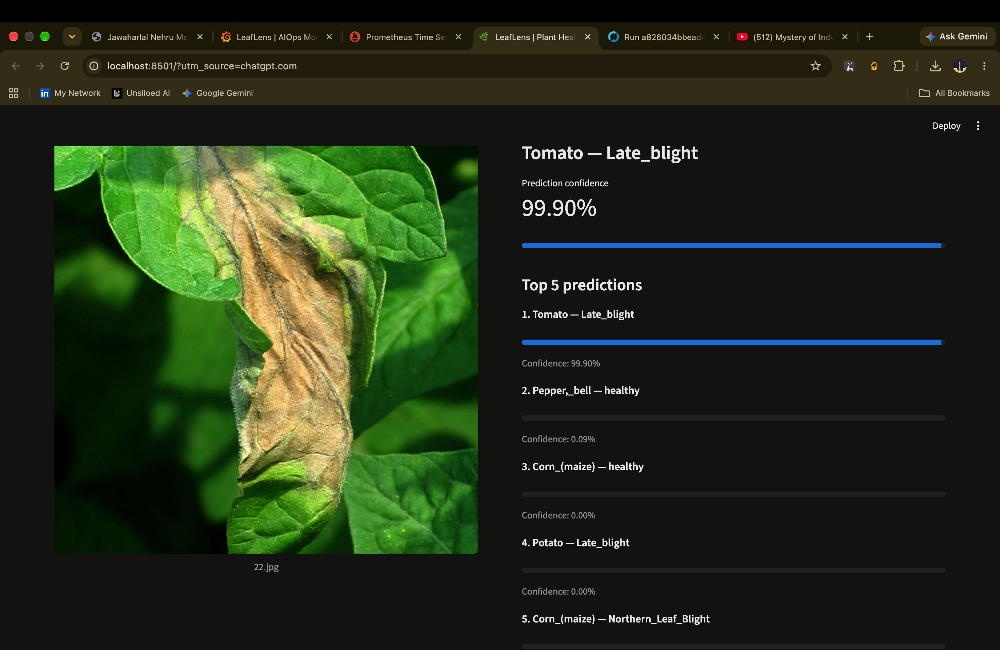
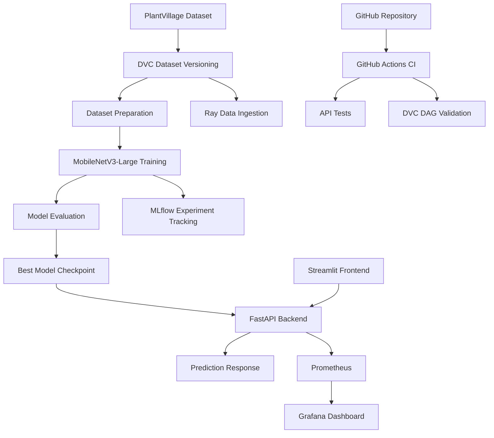
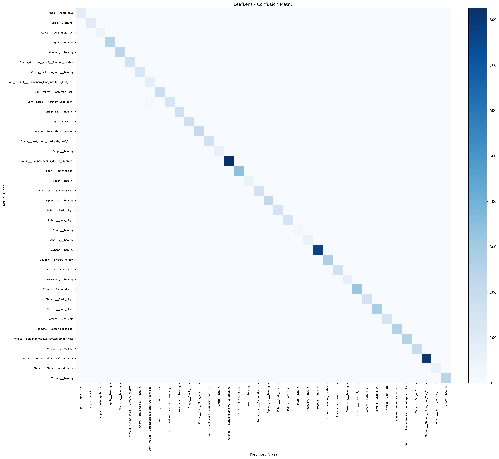
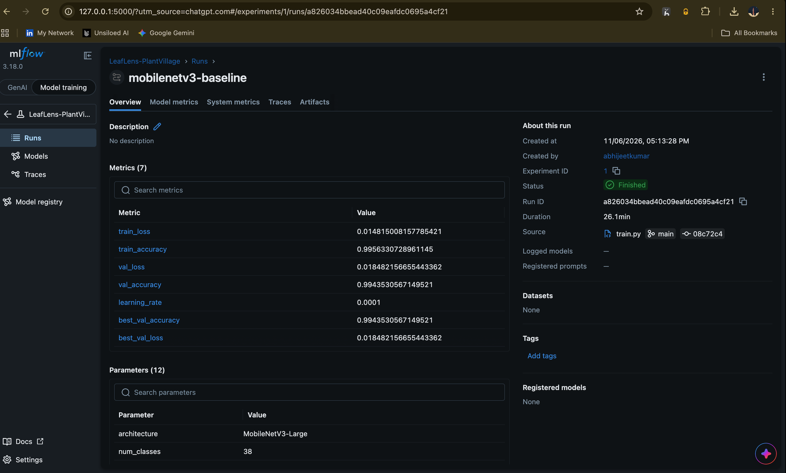
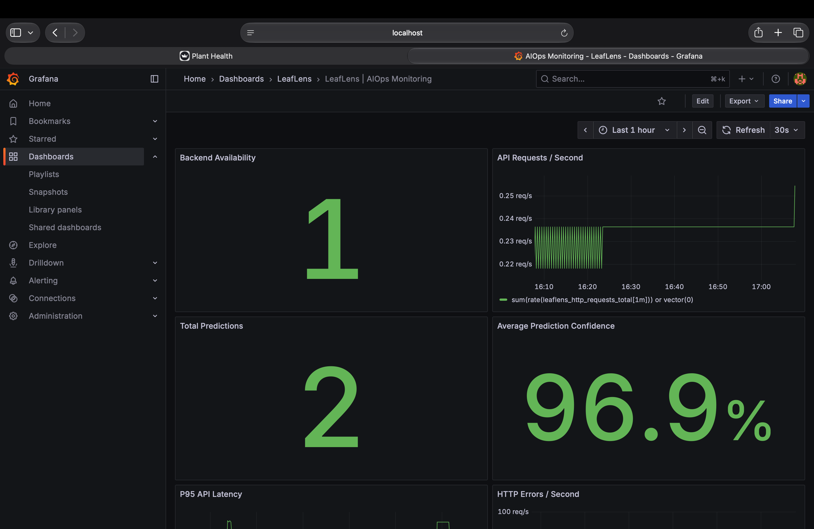
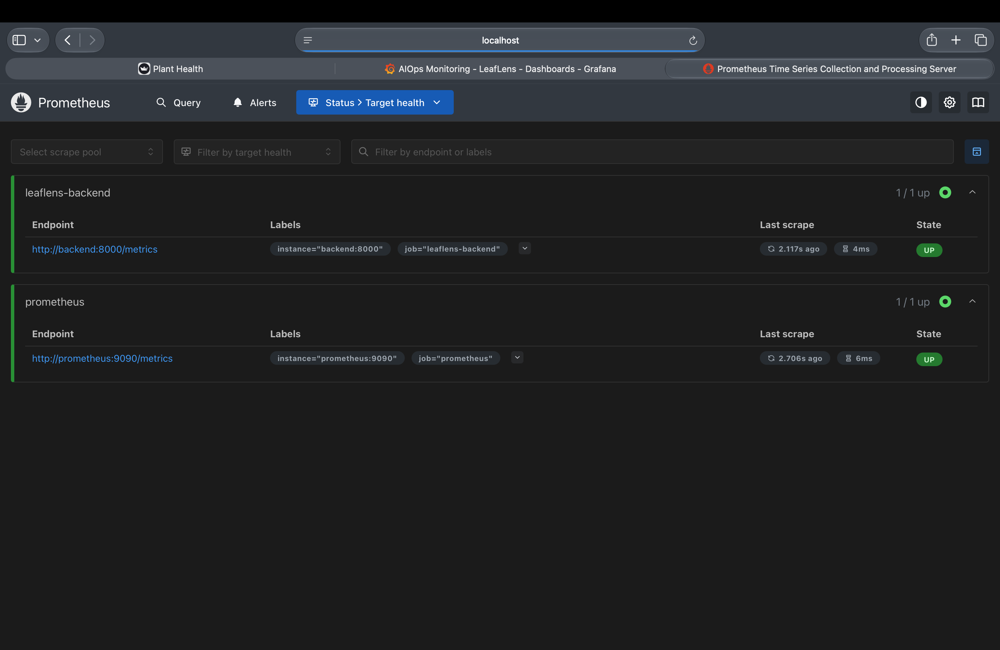
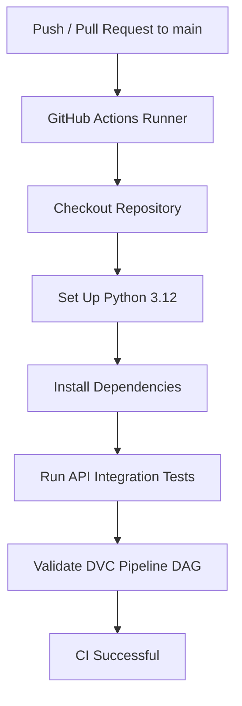
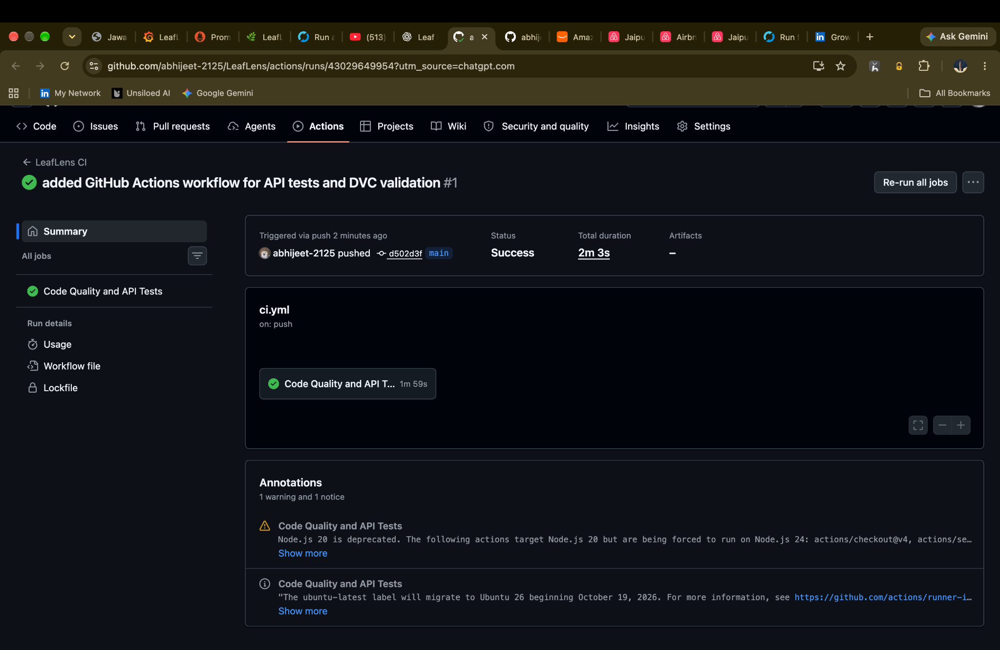

# LeafLens
### AI-Powered Plant Leaf Disease Detection with an End-to-End MLOps and AIOps Pipeline

<p align="center">
  
  
  
  
  
  
  
  
  
</p>

<p align="center">
  <a href="https://github.com/abhijeet-2125/LeafLens/actions/workflows/ci.yml">
    
  </a>
</p>

**LeafLens** is an end-to-end AI application that identifies plant leaf diseases from images using deep learning. It combines a MobileNetV3-Large image classification model with a reproducible ML pipeline, distributed data ingestion, experiment tracking, REST API inference, containerized deployment and real-time operational monitoring.

The project demonstrates the complete lifecycle of an AI application, from dataset preparation and model training to deployment, testing, monitoring and continuous integration.

**Author:** Abhijeet Kumar  
**Roll Number:** DA24B001   

---

## Application Preview

### 1. Application Homepage

The Streamlit frontend provides a simple interface through which users can upload a leaf image and request a disease prediction.



### 2. Disease Prediction

The application displays the predicted disease class, confidence score, and top alternative predictions.



---

## 1. Problem Statement

Plant diseases can significantly affect agricultural productivity. Early identification of plant diseases can help farmers and agricultural practitioners take timely action.

LeafLens addresses this problem through an image-based disease classification system.

A user uploads a photograph of a plant leaf, and the application processes the image through a trained deep learning model to predict its disease category.

Beyond model development, LeafLens incorporates MLOps and AIOps practices to make the application:

- Reproducible through dataset and pipeline versioning.
- Scalable through distributed data processing.
- Trackable through experiment management.
- Deployable through containerized services.
- Testable through automated API tests.
- Observable through Prometheus and Grafana.

## 2. Key Features

| Component | Implementation |
|---|---|
| Deep Learning | MobileNetV3-Large |
| Classification | 38 PlantVillage classes |
| Dataset Management | DVC |
| Data Processing | Ray Data |
| Experiment Tracking | MLflow |
| Backend | FastAPI |
| Frontend | Streamlit |
| Containerization | Docker |
| Service Orchestration | Docker Compose |
| Metrics Collection | Prometheus |
| Monitoring Dashboard | Grafana |
| Automated Testing | Pytest |
| Continuous Integration | GitHub Actions |

---

## 3. System Architecture

LeafLens consists of three major workflows:

1. **ML Pipeline:** Dataset preparation, model training, evaluation, and experiment tracking.
2. **Inference Pipeline:** Image upload, validation, preprocessing, model inference, and prediction response.
3. **Monitoring Pipeline:** Application metrics collection, Prometheus scraping, and Grafana visualization.

### High-Level Architecture



### Inference Workflow


---

## 4. User Interface

The frontend is implemented using Streamlit.

It provides:

- Image upload functionality.
- Image preview.
- Prediction initiation.
- Predicted disease category.
- Confidence score.
- Top-five alternative predictions.
- Model and inference device information.

The frontend communicates with the backend using a configurable API URL, maintaining separation between presentation and inference logic.

---

## 5. Dataset

LeafLens uses the PlantVillage dataset.

**Dataset source:** [PlantVillage Dataset — Kaggle](https://www.kaggle.com/datasets/abdallahalidev/plantvillage-dataset)

| Property | Value |
|---|---:|
| Total Images | 54,305 |
| Number of Classes | 38 |
| Image Dimensions | 256 × 256 |
| Image Format | RGB images, with one RGBA image converted to RGB |
| Training Samples | 38,013 |
| Validation Samples | 8,146 |
| Testing Samples | 8,146 |

### Dataset Splitting

A stratified split was performed using `random_state=42`.

| Split | Images | Percentage |
|---|---:|---:|
| Training | 38,013 | 70% |
| Validation | 8,146 | 15% |
| Testing | 8,146 | 15% |
| **Total** | **54,305** | **100%** |

The dataset manifest was validated for missing files, duplicate paths, and class representation.

- Missing image files: 0
- Duplicate paths: 0
- Classes represented in all three splits: 38

### Class Imbalance

The dataset is imbalanced. The smallest class contains 152 images, while the largest contains 5,507 images.

This is an important consideration when interpreting classification metrics, which is why macro-averaged precision, recall, and F1-score are also reported.

**Dataset license:** CC-BY-NC-SA-4.0. Refer to the original dataset source for usage and attribution requirements.

---

## 6. Model Architecture and Training

### Model: MobileNetV3-Large

LeafLens uses MobileNetV3-Large with pretrained ImageNet weights.

The pretrained classification head is adapted to predict 38 PlantVillage classes.

**Training configuration**

| Parameter | Value |
|---|---|
| Architecture | MobileNetV3-Large |
| Pretrained Weights | ImageNet |
| Input Resolution | 224 × 224 |
| Batch Size | 32 |
| Epochs | 5 |
| Optimizer | AdamW |
| Learning Rate | 0.0001 |
| Weight Decay | 0.0001 |
| Loss Function | CrossEntropyLoss |
| Training Device | Apple MPS |

### Training Results

| Epoch | Training Accuracy | Validation Accuracy |
|---|---:|---:|
| 1 | 92.52% | 98.80% |
| 2 | 98.84% | 99.40% |
| 3 | 99.21% | 99.39% |
| 4 | 99.31% | 98.82% |
| 5 | 99.56% | 99.44% |

The best validation accuracy was achieved at epoch 5.

### Final Test Evaluation

The selected model was evaluated on the held-out test set.

| Metric | Result |
|---|---:|
| Test Samples | 8,146 |
| Correct Predictions | 8,108 |
| Incorrect Predictions | 38 |
| Accuracy | **99.53%** |
| Macro Precision | 99.27% |
| Macro Recall | 99.34% |
| Macro F1-Score | 99.28% |

### Confusion Matrix



**Important evaluation limitation:** The results are based on a stratified random split of PlantVillage. Because this dataset contains controlled-background images and may contain visually similar or near-duplicate samples, these results should not be interpreted as guaranteed performance on real-world field photographs.

---

## 7. MLOps Pipeline

LeafLens uses multiple tools to manage the machine learning lifecycle.

### 7.1 DVC — Data and Pipeline Versioning

DVC is used to track the dataset and define a reproducible ML pipeline.

The pipeline contains three stages:

| Stage | Responsibility |
|---|---|
| `prepare_dataset` | Creates the stratified dataset manifest |
| `train_model` | Trains the MobileNetV3-Large model and records training metrics |
| `ray_ingest` | Processes image metadata and creates a Parquet output |

The pipeline dependency graph:

```text
                 PlantVillage Dataset
                         |
                +--------+--------+
                |                 |
           ray_ingest      prepare_dataset
                                  |
                             train_model
```

Useful commands:

```bash
# Display the pipeline DAG
dvc dag

# Execute changed pipeline stages
dvc repro

# Check pipeline and output status
dvc status
```

DVC tracks the raw dataset and pipeline outputs through its metadata and lockfile.

### 7.2 Ray Data — Distributed Data Processing

Ray Data is used to ingest and process the PlantVillage image dataset.

**Recorded ingestion results:**

| Metric | Result |
|---|---:|
| Total Images | 54,305 |
| Valid Images | 54,305 |
| Invalid Images | 0 |
| Classes | 38 |
| CPU Workers | 2 |
| Ray Blocks | 8 |
| Latest Recorded Ingestion Time | 5.788 seconds |
| Latest Recorded Throughput | 9,381.83 images/second |

The output metadata is stored as:

```text
data/processed/ray_image_metadata.parquet
```

The throughput is the recorded result from the local ingestion run and should not be interpreted as a universal production throughput guarantee.

### 7.3 MLflow — Experiment Tracking

MLflow is used to record model training experiments.

Tracked information includes:

- Training hyperparameters.
- Training and validation metrics.
- Model checkpoint artifacts.
- Training metadata.
- Run information.

The experiment is named:

```text
LeafLens-PlantVillage
```

MLflow uses a local SQLite tracking backend.

Start the MLflow UI:

```bash
mlflow ui \
  --backend-store-uri sqlite:///mlflow.db \
  --host 127.0.0.1 \
  --port 5000
```

Open:

```text
http://127.0.0.1:5000
```

### MLflow Experiment Evidence



---

## 8. Backend — FastAPI

The inference backend is developed using FastAPI.

### API Endpoints

| Method | Endpoint | Description |
|---|---|---|
| GET | `/` | Application information |
| GET | `/health` | Health check |
| POST | `/predict` | Predict plant disease from an image |
| GET | `/metrics` | Expose Prometheus metrics |

### Prediction API

Example request:

```bash
curl -X POST \
  "http://localhost:8000/predict" \
  -H "accept: application/json" \
  -F "file=@leaf.jpg"
```

The response includes:

- Predicted class.
- Prediction confidence.
- Top-five predictions.
- Model name.
- Inference device.

### Backend Features

- Image format validation.
- RGB conversion.
- Maximum upload size of 10 MB.
- Structured prediction response using Pydantic.
- Exception handling.
- Application logging.
- Prometheus instrumentation.

---

## 9. Docker Deployment

LeafLens uses Docker Compose to run four independent services.

| Service | Host Port | Purpose |
|---|---:|---|
| Backend | 8001 | FastAPI inference service |
| Frontend | 8501 | Streamlit user interface |
| Prometheus | 9092 | Metrics collection |
| Grafana | 3002 | Monitoring dashboards |

### Start the Application

Build the backend and frontend images:

```bash
docker build -t leaflens-backend:latest -f backend/Dockerfile .
docker build -t leaflens-frontend:latest -f frontend/Dockerfile .
```

Start all services:

```bash
docker compose up -d
```

Check service status:

```bash
docker compose ps
```

View logs:

```bash
docker compose logs -f
```

Stop services:

```bash
docker compose down
```

### Access the Application

| Component | URL |
|---|---|
| Streamlit Frontend | http://localhost:8501 |
| FastAPI Backend | http://localhost:8001 |
| API Documentation | http://localhost:8001/docs |
| Prometheus | http://localhost:9092 |
| Grafana | http://localhost:3002 |

The local Grafana credentials configured for this project are:

```text
Username: admin
Password: leaflens_local_admin
```

Change these credentials before exposing the service outside a local development environment.

---

## 10. Monitoring and Observability

LeafLens integrates Prometheus and Grafana for operational monitoring.

### Prometheus Instrumentation

The FastAPI backend exposes metrics through `/metrics`.

The instrumentation includes:

- HTTP request counters.
- HTTP request duration histogram.
- Prediction counters by disease class.
- Prediction confidence histogram.
- Prediction failure counter.

### Grafana Dashboard

The provisioned dashboard is named:

**LeafLens | AIOps Monitoring**

It contains eight monitoring panels:

1. Backend availability.
2. API request rate.
3. Total predictions.
4. Average prediction confidence.
5. P95 API latency.
6. HTTP errors per second.
7. Prediction failures.
8. Predictions by disease class.

### Grafana Dashboard Evidence



### Prometheus Target Health



These dashboards provide visibility into application availability, inference activity, latency, errors, and prediction behaviour.

---

## 11. Testing

The backend API test suite contains eight tests covering:

| Test | Purpose |
|---|---|
| Root endpoint | Verifies application information |
| Health endpoint | Verifies service health |
| Successful prediction | Verifies prediction response structure |
| Empty upload | Checks empty-file rejection |
| Invalid image | Checks invalid image handling |
| Oversized upload | Checks the 10 MB upload limit |
| Prometheus metrics endpoint | Verifies metrics exposure |
| Prediction metrics recording | Verifies prediction instrumentation |

### Run Tests

```bash
pytest backend/tests/test_prediction_api.py -v
```

**Recorded result: 8 tests passed.**

The CI API tests use a mocked predictor and synthetic in-memory images. They validate API behaviour without loading the real trained model or requiring the PlantVillage dataset.

The model's classification performance is evaluated separately using the held-out test dataset.

---

## 12. Continuous Integration — GitHub Actions

LeafLens uses GitHub Actions to automate validation whenever changes are pushed to the `main` branch or a pull request targets `main`.

Workflow file:

```text
.github/workflows/ci.yml
```

### CI Workflow



### Automated Checks

| Check | Description |
|---|---|
| Environment Setup | Python 3.12 |
| API Testing | Pytest integration tests |
| DVC Validation | Executes `dvc dag` |
| Trigger | Push and pull requests to `main` |

### Successful GitHub Actions Run

The first GitHub Actions execution completed successfully.



**First CI run:** Successful  
**Commit:** `d502d3f`  
**Workflow:** LeafLens CI

View the workflow:

[GitHub Actions — LeafLens CI](https://github.com/abhijeet-2125/LeafLens/actions/workflows/ci.yml)

---

## 13. Project Structure

```text
LeafLens/
│
├── .github/
│   └── workflows/
│       └── ci.yml
│
├── artifacts/
│   ├── metrics/
│   └── models/
│
├── backend/
│   ├── app/
│   │   ├── core/
│   │   ├── schemas/
│   │   └── main.py
│   ├── tests/
│   │   └── test_prediction_api.py
│   ├── Dockerfile
│   └── requirements.txt
│
├── data/
│   ├── raw/
│   └── processed/
│
├── docs/
│   ├── architecture/
│   ├── design/
│   ├── screenshots/
│   ├── testing/
│   └── user_manual/
│
├── frontend/
│   ├── app.py
│   └── Dockerfile
│
├── ml/
│   ├── evaluation/
│   ├── preprocessing/
│   ├── serving/
│   └── training/
│
├── pipelines/
│   └── ray_ingestion.py
│
├── docker-compose.yml
├── dvc.yaml
├── dvc.lock
├── pyproject.toml
├── README.md
└── .gitignore
```

---

## 14. Project Documentation

The project includes five mandatory technical documents.

| Document | Location |
|---|---|
| Architecture Document | `docs/architecture/Architecture_Document.pdf` |
| High-Level Design | `docs/design/High_Level_Design.pdf` |
| Low-Level Design | `docs/design/Low_Level_Design.pdf` |
| Test Plan and Report | `docs/testing/Test_Plan_and_Report.pdf` |
| User Manual | `docs/user_manual/User_Manual.pdf` |

These documents describe the architecture, design decisions, API specifications, testing methodology, results, and application usage.

---

## 15. Limitations

- The model was evaluated on a stratified random split of PlantVillage, not an independently collected field dataset.
- Controlled image backgrounds may make real-world generalization more challenging.
- Potential near-duplicate or visually similar images may influence random-split evaluation.
- The API CI tests use a mocked predictor and do not validate real-model inference.
- The CI workflow validates the DVC DAG but does not execute model training or data ingestion.
- The current application is designed as a local deployment demonstration rather than a production agricultural diagnostic service.

## 16. Future Improvements

Potential future improvements include:

- Evaluation on independently collected field photographs.
- External validation across different lighting and environmental conditions.
- Model calibration and uncertainty estimation.
- Model explainability using Grad-CAM.
- Automated DVC pipeline execution in CI.
- More comprehensive real-model inference tests.
- Model performance and drift monitoring.
- Secure deployment with authentication and managed secrets.
- Cloud-based deployment and scalable inference.

## 17. Acknowledgements

- [PlantVillage Dataset](https://www.kaggle.com/datasets/abdallahalidev/plantvillage-dataset)
- [PyTorch](https://pytorch.org/)
- [Torchvision](https://pytorch.org/vision/)
- [FastAPI](https://fastapi.tiangolo.com/)
- [Streamlit](https://streamlit.io/)
- [DVC](https://dvc.org/)
- [Ray](https://www.ray.io/)
- [MLflow](https://mlflow.org/)
- [Docker](https://www.docker.com/)
- [Prometheus](https://prometheus.io/)
- [Grafana](https://grafana.com/)

---
  <a href="https://github.com/abhijeet-2125/LeafLens">View LeafLens on GitHub</a>
</p>
